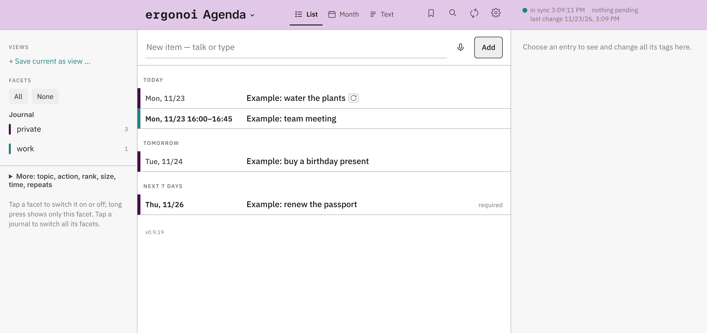

# ergonoi Agenda

An open and lightweight planning journal, cross-device and confidential by design.



Appointments, tasks and notes in one journal, as in a paper notebook, but rearranged and moved with a tap. It runs in any browser and can be installed as an app. Journals are encrypted in the browser: the server stores and relays lines it cannot read.

- **Documentation:** https://ergonoi.github.io/ergonoi-agenda/ (English, German)
- **ergonoi:** https://ergonoi.com
- **ergonoi Map**, the mind map of the same family: https://github.com/ergonoi/ergonoi-map

## What it does

- One journal per person, further journals shared with others as owner, ally (reads and writes) or guest (reads)
- Your account stays with you alone: a list of words, kept by you, opens your journals. There is no sign-up with e-mail or password, and the server never learns who you are or what you write
- Works offline and catches up later; a journal can also be kept as a local file
- Daily backups on the server and in the browser; deleting a journal removes every copy that is still connected
- Further servers keep an up-to-date copy, written by the clients
- The journal is plain text, one line per entry, readable and writable by hand

## Running a server

One Go binary with the web client inside. Requires Go 1.22 or later.

```
go build -o agenda-service ./server
./agenda-service -data accounts
```

Then open http://127.0.0.1:41380/. Setting it up behind HTTPS: [deploy/DEPLOY.md](deploy/DEPLOY.md).

## Technical documentation

- [Decisions](docs/decisions.md): what was decided and why
- [Architecture](docs/architecture.md): format, change model, encryption, service interface
- [User interface](docs/ui.md): design rules and components
- Building the web client and its tests: `clients/web/build.py`, [clients/web/e2e](clients/web/e2e)

Author: Markus Schatzl
